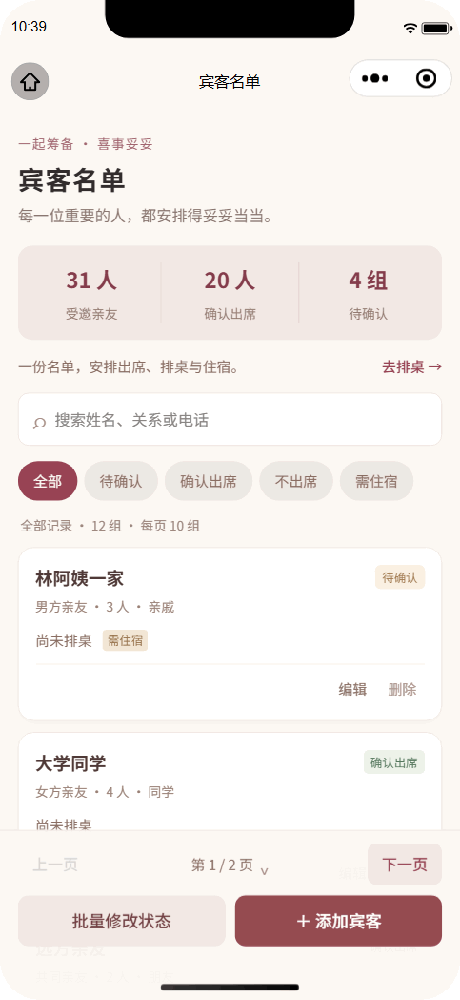
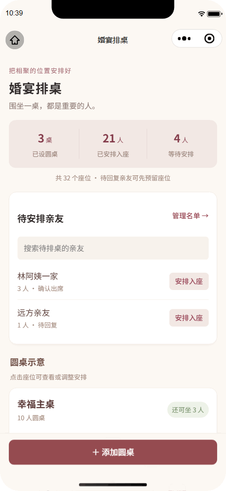

<p align="center">
  
</p>
<p align="center"><a href="README.md">简体中文</a> · <b>English</b></p>
<p align="center"><b>Plan on your own, or together with family.</b><br />Keep wedding tasks, guest arrangements and the day's schedule in one shared plan.</p>

<!-- badges:start -->
<p align="center">
  
  <a href="LICENSE"></a>
  
  <a href="https://uniapp.dcloud.net.cn/"></a>
  <a href="https://vuejs.org/"></a>
</p>
<p align="center">
  <a href="https://www.typescriptlang.org/"></a>
  
  
  
  
</p>
<!-- badges:end -->

<p align="center"><a href="#see-it-in-action">See it in action</a> · <a href="#features">Features</a> · <a href="#getting-started">Getting started</a> · <a href="#local-development">Local development</a> · <a href="#cloud-deployment">Cloud deployment</a></p>

## See it in action

<p align="center">Demos use fictional data. The mini program interface is currently in Chinese.</p>

<table align="center">
  <tr>
    <td width="50%" align="center" valign="top">
      <b>Guests &amp; bulk updates</b><br />
      <sub>Browse 10 records per page and update guest statuses together</sub><br /><br />
      <a href="docs/assets/guests-demo.gif" title="View the full-size animation"></a>
    </td>
    <td width="50%" align="center" valign="top">
      <b>Round-table seating</b><br />
      <sub>Seat unassigned guests and see available table capacity</sub><br /><br />
      <a href="docs/assets/seating-demo.gif" title="View the full-size animation"></a>
    </td>
  </tr>
</table>

## Features

| Feature | What you can do |
| --- | --- |
| Wedding overview | Keep names, date and venue together; view the countdown and progress based on the proportion of completed tasks. |
| Personal & family modes | Start on your own, then let the owner enable family collaboration for the same wedding. |
| Planning tasks | Add, assign and complete tasks, set due dates and work through preparation stages. |
| Supplies | Organize wedding items, quantities and preparation status. |
| Vendors | Keep contact details, quotes, discussion notes and booking status together. |
| Guests | Browse 10 guest or family records per page, jump between pages, and search or filter the list. Select across pages or all filtered results to update attendance, accommodation needs and guest groups in bulk. |
| Round-table seating | Use 10 seats, 12 seats or a custom capacity. Select only unassigned guests and tables with enough room, and view their seats. |
| Wedding-day timeline | Plan times, responsible people and notes for each part of the day. |
| Accommodation | Select guests who need accommodation, then organize hotels, rooms and stays. |
| Data export | Export planning information as XLSX files for backups, printing and handovers. |

## Getting started

1. **Create a wedding.** Start a personal wedding, accessible only to you by default. Enter the date and venue; other details can follow.
2. **Organize the preparation.** Add tasks, supplies and vendors, and track progress and responsibilities.
3. **Arrange guests.** Record party sizes, attendance and accommodation needs, then assign tables and rooms.
4. **Invite family to help.** When needed, enable family collaboration in Wedding Settings and share the invitation code. Members can view and edit planning information.
5. **Prepare for the day.** Complete the timeline and export information for family members and on-site helpers.

For your first self-hosted setup, complete [local development](#local-development) and [cloud deployment](#cloud-deployment) first.

<details>
<summary><b>How do personal and family modes work?</b></summary>

New weddings start in personal mode without an invitation code. Each group plans one wedding. The owner can enable family collaboration and return to personal mode after removing other members, keeping the existing planning data.

Returning to personal mode invalidates old invitation codes. Enabling collaboration again creates a new code. Existing family groups remain collaborative. Deploy the updated `xishiTuotuoApi` cloud function before using the new client and its mode switch.

</details>

<details>
<summary><b>How are member profiles and WeChat accounts used?</b></summary>

Family members can edit their own group display name, role and avatar. The owner can also edit other members' display names and roles; avatars can only be chosen by the members themselves.

Existing members may choose to sign in with WeChat and complete their profile, or skip sign-in. Skipping does not block planning features, and members can sign in later. Avatars require an explicit choice; nicknames can use WeChat's quick-fill option. Personal profile information is not fetched automatically.

Members are identified by their WeChat accounts. Account labels distinguish members with the same name; avatars and display names are not real-name verification. Members join with invitation codes, without an additional owner-approval step.

</details>

<details>
<summary><b>How do I delete a wedding and manage existing data?</b></summary>

Export any information you want to keep first. At the bottom of Wedding Settings, the owner can enter the complete wedding name to confirm permanent deletion.

Deletion cannot be undone. It clears planning data, members, guests and cloud files, and invalidates old invitation codes. If cloud-file cleanup fails, the owner can retry from the wedding list. Copies already exported, downloaded or forwarded cannot be recalled.

The server retains only a minimal deletion marker without wedding or guest information, for repeated requests and failed cleanup.

</details>

## Local development

Use Node.js 20 or newer and WeChat DevTools. The frontend uses Vue 3 single-file components and TypeScript, compiled to a WeChat mini program with the [official uni-app toolchain](https://uniapp.dcloud.net.cn/worktile/CLI.html).

```powershell
git clone https://github.com/JackieYangon/xishi-tuotuo.git
cd xishi-tuotuo
npm ci
if (!(Test-Path -LiteralPath .env.local)) { Copy-Item .env.example .env.local }
# Set your own WECHAT_APPID and CLOUD_ENV_ID in .env.local.
npm run build:mp-weixin
```

Import the repository root into WeChat DevTools. The generated `project.config.json` points to `dist/build/mp-weixin/` for the mini program and `cloudfunctions/` for cloud functions.

| Command | Purpose |
| --- | --- |
| `npm run build:mp-weixin` | Build the production mini program |
| `npm run dev:mp-weixin` | Continuously compile the development mini program |
| `npm run setup` | Generate local configuration and the version module |
| `npm test` | Run automated tests |
| `npm run type-check` | Check TypeScript types |
| `npm run check` | Check syntax, configuration and page completeness |

Edit `.vue` pages under `src/pages/` and rebuild. Watch mode switches to `dist/dev/mp-weixin/`; a production build restores the production directory. Reopen the DevTools project after switching modes. Do not edit or commit generated files in `dist/`.

### Local configuration

Set these values in `.env.local`:

| Setting | What to enter |
| --- | --- |
| `WECHAT_APPID` | This mini program's AppID |
| `CLOUD_ENV_ID` | The **full environment ID** from the cloud console, not its display name |
| `CLOUD_RESOURCE_APPID` | The AppID that owns a shared environment; leave blank for this mini program's own environment |

For an environment owned by another mini program, its owner must **authorize this mini program in the cloud console first**, then supply the resource-owner AppID. Do not swap `WECHAT_APPID` and `CLOUD_RESOURCE_APPID` or repeat the same AppID in both fields.

Keep AppIDs and environment IDs in local configuration, not shared source files. Never put an AppSecret, access token or service credential in the frontend, README or Git commits.

<details>
<summary><b>Check source code without connecting to the cloud</b></summary>

```powershell
node scripts/prepare-local-config.cjs --example
npm test
npm run type-check
npm run check
```

Example configuration disables cloud access. Run `npm run setup` again before connecting to a real environment.

</details>

## Cloud deployment

Use this mini program's own environment or a shared cloud environment. Dedicated resource names and server-side identity checks isolate wedding data.

| Resource | Project name |
| --- | --- |
| Cloud function | `xishiTuotuoApi` |
| Database collection | `xishi_tuotuo_groups` |
| Cloud storage prefix | `xishi-tuotuo/` |

1. **Prepare configuration.** Fill in `.env.local`. For an environment shared by another mini program, complete its owner's authorization and set `CLOUD_RESOURCE_APPID`, then run `npm run setup`.
2. **Create the collection.** Create `xishi_tuotuo_groups` in the target environment and set permissions to **administrator-only read and write**. Clients access data through the cloud function, never directly.
3. **Deploy the cloud function.** In WeChat DevTools, right-click `cloudfunctions/xishiTuotuoApi` and select **Upload and deploy: install dependencies in the cloud**. Confirm the target environment. Deploy only this function, including its generated `local-config.json`.
4. **Start planning.** Compile the mini program and create a personal wedding. When collaboration is needed, the owner enables family collaboration and invites members to join using their own WeChat accounts.

Deploy the updated cloud function before using a new client. The server obtains identity from the WeChat runtime context and checks the mini program AppID and group membership. Client-supplied user identifiers are not trusted identities.

In a shared environment, create or update only this project's resources listed above. **Do not overwrite another mini program's functions, collections or files, or change environment-wide storage rules.** Files must use the dedicated `xishi-tuotuo/` prefix; any added file feature must have access rules appropriate to its intended audience.

### Configuration maintenance

Run `npm run setup` again after changing the AppID, cloud environment, resource-owner AppID or version. Redeploy this project's cloud function when its configuration changes. Resource-sharing authorization does not change the dedicated collection, file prefix or member permissions, and does not require changes to environment-wide security rules.

The `version` in `package.json` is the only version source. `npm run setup` generates the mini program's version module. After updating the version, run `npm run docs:badges` to synchronize both README version badges. Edit `project.config.template.json` for shared project settings.

<details>
<summary><b>Which local files should stay out of Git?</b></summary>

- `.env.local`
- `project.config.json` and `project.private.config.json`
- `src/config.local.json`, `src/version.json` and `src/manifest.json`
- `cloudfunctions/xishiTuotuoApi/local-config.json`
- `dist/`

</details>

## License

This project is licensed under the [MIT License](LICENSE).
