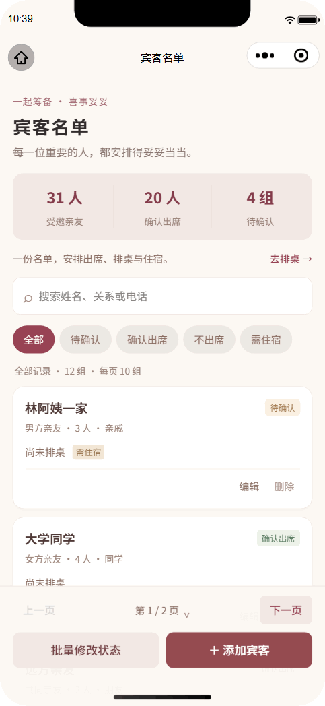
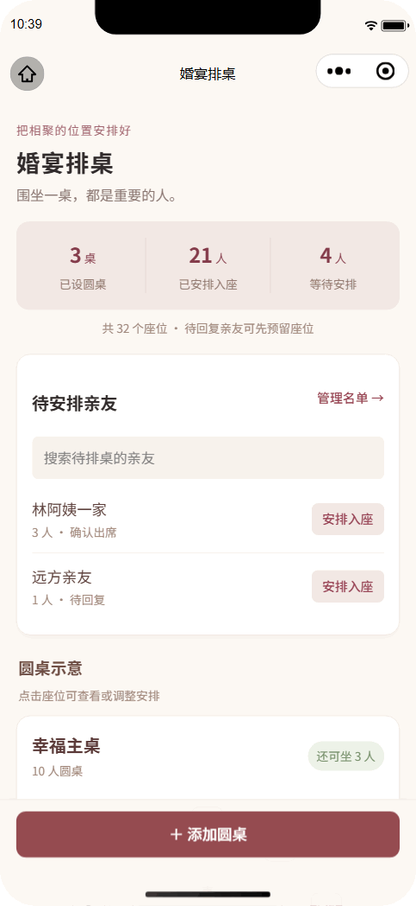

<p align="center">
  
</p>
<p align="center"><b>简体中文</b> · <a href="README.en.md">English</a></p>
<p align="center"><b>一个人能用，一家人也能一起筹备。</b><br />把婚礼事项、亲友安排和当天流程，放在同一份筹备计划里。</p>

<!-- badges:start -->
<p align="center">
  
  <a href="LICENSE"></a>
  
  <a href="https://uniapp.dcloud.net.cn/"></a>
  <a href="https://vuejs.org/"></a>
</p>
<p align="center">
  <a href="https://www.typescriptlang.org/"></a>
  
  
  
  
</p>
<!-- badges:end -->

<p align="center"><a href="#功能演示">功能演示</a> · <a href="#主要功能">主要功能</a> · <a href="#开始使用">开始使用</a> · <a href="#本地开发">本地开发</a> · <a href="#云开发部署">云开发部署</a></p>

## 功能演示

<p align="center">演示使用虚构数据；小程序界面目前为中文。</p>

<table align="center">
  <tr>
    <td width="50%" align="center" valign="top">
      <b>宾客与批量修改</b><br />
      <sub>每页 10 组，集中更新出席与住宿状态</sub><br /><br />
      <a href="docs/assets/guests-demo.gif" title="点击查看完整动图"></a>
    </td>
    <td width="50%" align="center" valign="top">
      <b>圆桌排座</b><br />
      <sub>安排待入座亲友，清楚查看桌位余量</sub><br /><br />
      <a href="docs/assets/seating-demo.gif" title="点击查看完整动图"></a>
    </td>
  </tr>
</table>

## 主要功能

| 功能 | 可以做什么 |
| --- | --- |
| 婚礼总览 | 记录新人、婚期和地点，查看倒计时与按事项完成比例计算的筹备进度。 |
| 个人与家庭协作 | 默认独立筹备；需要时由创建者开启家庭协作，共同管理同一场婚礼。 |
| 筹备事项 | 添加、分配和完成事项，记录截止日期，按准备阶段推进。 |
| 物品清单 | 整理婚礼用品、数量和准备状态。 |
| 商家记录 | 集中保存联系方式、报价、沟通备注和预订状态。 |
| 亲友宾客 | 每页 10 组，支持翻页、选页和搜索筛选；跨页勾选或全选筛选结果，批量修改出席、住宿和亲友分组。 |
| 圆桌排座 | 支持 10 人桌、12 人桌及自定义容量；只选择未排座亲友和余位足够的桌子，直观查看座位。 |
| 当天流程 | 按时间整理各个环节、负责人和注意事项。 |
| 住宿安排 | 从需要住宿的亲友中选择人员，记录酒店、房间和入住安排。 |
| 数据导出 | 导出 XLSX 筹备资料，用于备份、打印和交接。 |

## 开始使用

1. **建立婚礼。** 创建个人婚礼，默认仅自己可访问；填写婚期和场地，其余资料可以稍后补充。
2. **整理筹备工作。** 添加事项、物品和商家，记录进度与负责人。
3. **安排亲友。** 录入同行人数、出席与住宿需求，再分配桌位和房间。
4. **邀请家人协作。** 需要家人帮忙时，在「婚礼设置」开启家庭协作，再分享邀请码；加入的成员可以查看和编辑筹备资料。
5. **准备婚礼当天。** 补充当天流程，按需导出资料，供家人和现场工作人员查阅。

首次自行搭建，请先完成[本地开发](#本地开发)和[云开发部署](#云开发部署)。

<details>
<summary><b>个人筹备与家庭协作如何切换？</b></summary>

新建婚礼默认为个人筹备，不生成邀请码；每个群组仅筹备一场婚礼。创建者可主动开启家庭协作，在移除其他成员后也可切回个人筹备，原有资料保留。

切回个人筹备会立即使旧邀请码失效；再次开启协作会生成新邀请码。已有家庭群组继续保持协作模式。使用新版客户端和模式切换前，需先部署更新后的 `xishiTuotuoApi` 云函数。

</details>

<details>
<summary><b>成员资料与微信账号如何使用？</b></summary>

「筹备家人」支持修改自己的群内称呼、身份和头像。群主也能修改其他成员的群内称呼和身份，头像只能本人选择。

现有成员可选择「微信登录并完善资料」或「暂不登录」；跳过不影响筹备功能，以后也可再次登录。头像需主动选择，昵称可使用微信提供的快捷填写，不会自动读取个人资料。

成员始终通过微信账号识别，账号标记用于区分同名成员；头像和称呼不代表实名验证。入群使用邀请码，不增加群主审核。

</details>

<details>
<summary><b>如何删除婚礼与处理已有资料？</b></summary>

请先导出需要保留的资料。创建者可在「婚礼设置」底部完整输入婚礼名称，确认永久删除群组。

删除不可恢复，会清空筹备资料、成员、宾客和云文件，并使旧邀请码失效。云文件清理失败时，群主可在「我参与的婚礼」重试清理；已导出、下载或转发的副本无法撤回。

云端仅保留不含婚礼和宾客资料的最小删除标记，用于重复请求和失败清理。

</details>

## 本地开发

需要 Node.js 20 或更高版本，以及微信开发者工具。前端使用 Vue 3 单文件组件和 TypeScript，通过 [uni-app 官方工具链](https://uniapp.dcloud.net.cn/worktile/CLI.html) 编译为微信小程序。

```powershell
git clone https://github.com/JackieYangon/xishi-tuotuo.git
cd xishi-tuotuo
npm ci
if (!(Test-Path -LiteralPath .env.local)) { Copy-Item .env.example .env.local }
# 在 .env.local 填写自己的 WECHAT_APPID 和 CLOUD_ENV_ID
npm run build:mp-weixin
```

用微信开发者工具导入仓库根目录。生成的 `project.config.json` 将小程序目录指向 `dist/build/mp-weixin/`，云函数目录指向 `cloudfunctions/`。

| 命令 | 用途 |
| --- | --- |
| `npm run build:mp-weixin` | 构建生产版小程序 |
| `npm run dev:mp-weixin` | 持续编译开发版小程序 |
| `npm run setup` | 生成本地配置和版本模块 |
| `npm test` | 运行自动化测试 |
| `npm run type-check` | 检查 TypeScript 类型 |
| `npm run check` | 检查语法、配置和页面完整性 |

编辑 `src/pages/` 下的 `.vue` 页面后重新构建。持续开发会自动切换到 `dist/dev/mp-weixin/`，生产构建会恢复生产目录；切换模式后重新打开开发者工具项目。不要编辑或提交 `dist/` 中的编译结果。

### 本地配置

在 `.env.local` 中填写：

| 配置项 | 填写说明 |
| --- | --- |
| `WECHAT_APPID` | 本小程序的 AppID |
| `CLOUD_ENV_ID` | 云开发控制台显示的**完整环境 ID**，不能使用环境昵称 |
| `CLOUD_RESOURCE_APPID` | 共享环境所属小程序的 AppID；使用本小程序自己的环境时留空 |

跨小程序使用共享环境时，先由**资源方在云开发控制台授权本小程序访问**，再填写资源方 AppID。不要交换 `WECHAT_APPID` 和 `CLOUD_RESOURCE_APPID`，同一个 AppID 不需要填写两次。

AppID 和环境 ID 只存放于本地配置，不写入共享源文件。不要在前端、README 或 Git 提交中放入 AppSecret、访问令牌和服务密钥。

<details>
<summary><b>只检查源码，不连接云端</b></summary>

```powershell
node scripts/prepare-local-config.cjs --example
npm test
npm run type-check
npm run check
```

示例配置禁用云访问；连接真实环境前重新执行 `npm run setup`。

</details>

## 云开发部署

可使用本小程序自己的环境或共享云开发环境，通过独立资源命名与云端身份校验隔离婚礼数据。

| 资源 | 本项目名称 |
| --- | --- |
| 云函数 | `xishiTuotuoApi` |
| 数据库集合 | `xishi_tuotuo_groups` |
| 云存储目录前缀 | `xishi-tuotuo/` |

1. **准备配置。** 填写 `.env.local`。跨小程序共享环境时先完成资源方授权并填写 `CLOUD_RESOURCE_APPID`，然后运行 `npm run setup`。
2. **创建集合。** 在目标环境创建 `xishi_tuotuo_groups`，权限设为**仅管理员可读写**。客户端通过云函数操作数据，不直接读写集合。
3. **部署云函数。** 在微信开发者工具中右键 `cloudfunctions/xishiTuotuoApi`，选择**上传并部署：云端安装依赖**，确认目标环境。仅部署这个函数，并包含本地生成的 `local-config.json`。
4. **开始使用。** 编译小程序，创建个人婚礼；需要多人协作时，由创建者开启家庭协作，再邀请成员在各自微信账号下加入。

使用新版客户端前，先部署更新后的云函数。云端从微信运行上下文取得身份，并核对本小程序 AppID 和群组成员权限；不要将客户端传入的用户标识当作可信身份。

共享环境中只创建或更新上表列出的本项目资源。**不覆盖其他小程序的函数、集合和文件，不修改全环境存储安全规则。** 文件需使用 `xishi-tuotuo/` 独立路径；新增文件能力时同时配置与其访问范围相符的规则。

### 配置维护

更换 AppID、云环境、资源方 AppID 或版本后，重新运行 `npm run setup`；云函数配置变化后，重新部署本项目云函数。资源共享授权不改变专用集合、文件目录和成员权限，也不需要修改全环境安全规则。

`package.json` 的 `version` 是唯一版本来源，`npm run setup` 自动生成小程序版本模块。升级版本后运行 `npm run docs:badges`，同步两份 README 的版本徽章。共享项目设置修改 `project.config.template.json`。

<details>
<summary><b>哪些本地文件不应提交 Git？</b></summary>

- `.env.local`
- `project.config.json`、`project.private.config.json`
- `src/config.local.json`、`src/version.json`、`src/manifest.json`
- `cloudfunctions/xishiTuotuoApi/local-config.json`
- `dist/`

</details>

## 许可证

本项目采用 [MIT 许可证](LICENSE)。
